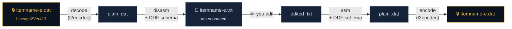

<div align="center">


# L2 Native File Editor

**The classic Lineage II client file editor, rebuilt from scratch for macOS and Linux.**<br>
Decrypt, edit and re-encrypt client tables, with no Wine, no CrossOver and no Windows VM.

<br>


<br>

**48 / 48** golden files byte-identical to the original tools &nbsp;·&nbsp;
**4,069** table schemas &nbsp;·&nbsp; **54** chronicles &nbsp;·&nbsp; **9** encryption protocols

</div>

---

## Why

For over a decade, editing Lineage II client files meant **L2 File Editor by Miko**: a 32-bit Delphi
app that shells out to closed-source Windows tools. On a Mac or a Linux box that meant Wine,
CrossOver or a VM, plus a lot of hoping.

This project replaces the whole stack with native code. The binary `.dat` format engine was
re-implemented in Swift and verified **byte for byte** against the original l2disasm/l2asm on a real
client corpus. Same files in, same bytes out.

## Features

|  |  |
|---|---|
| 🔓 **Open & Decrypt** | Reads the `Lineage2Ver###` header and picks the protocol for you: XOR (111/120/121), Blowfish (211/212) and RSA (411–414). |
| 📜 **dat ⇄ txt** | Turns binary tables (`itemname`, `skillgrp`, `npcgrp`, …) into tab-separated text you can actually edit, then rebuilds them exactly. |
| 🗺️ **54 chronicles** | Bundled DDF schemas from C3 and Interlude through Gracia, High Five and the GoD era, in regional variants. |
| 🔐 **Save & Encrypt** | Assemble, encrypt and write back in one step. The previous file is kept as `.bak`. |
| 📝 **ini / int / htm** | Encrypted text files are decoded with BOM sniffing and saved in their original encoding. |
| ⌨️ **`l2dat` CLI** | Every step is scriptable: `decode`, `encode`, `disasm`, `asm`, `open`, `save`, `roundtrip`. |

### Two apps, one engine

- **macOS:** a native SwiftUI app with TextKit 2, a find bar, a Program Log and a chronicle and
  protocol picker.
- **macOS + Linux:** a Tauri 2 app with a CodeMirror 6 editor, find & replace and go-to-line,
  packaged as AppImage, `.deb` and `.rpm`.

## How it works



| Layer | What it does |
|---|---|
| `L2Dat` | Pure Swift: DDF schema lexer and parser, a streaming two-pass record reader, disassembler and assembler. Portable to Linux. |
| `L2Crypt` | Drives the bundled [open-l2encdec](https://github.com/ritsuwastaken/open-l2encdec) helper in its own process group, with timeouts and cancellation. It checks the protocol against the file header before encrypting anything. |
| `l2dat` | The CLI over both. |
| Apps | SwiftUI (macOS) and Tauri (macOS + Linux). The Tauri app is a thin shell over `l2dat`, so both apps share one engine. |

### Built not to eat your files

- **Atomic saves.** Outputs are written to private temp files and renamed into place only when
  every output is complete. If anything fails, it rolls back.
- **Interrupt-safe.** Ctrl-C, SIGTERM and SIGHUP kill the helper's whole process group and clean
  up its temp files.
- **Same-file detection by inode, not by spelling.** It knows that `Item.dat` and `item.dat` are the
  same file on a case-insensitive disk.
- **Edge cases are tested.** Empty wide strings, NaN bounds and oversized counters all have tests,
  on top of the golden corpus.

## Download

Grab the latest build from **[Releases](https://github.com/intersector/l2-native-file-editor/releases)**.

| Platform | File |
|---|---|
| macOS (Apple Silicon), native SwiftUI app | `L2-File-Editor-macOS-arm64.zip` |
| macOS (Apple Silicon), cross-platform app | `L2-File-Editor-Tauri-macOS-arm64.dmg` |
| Linux x86_64 | `L2-File-Editor-linux-x86_64.AppImage` · `.deb` · `.rpm` (glibc 2.39+) |

Both macOS apps are called *L2 File Editor*, so install one of them.

> **First launch on macOS:** the apps are not notarized yet, so Gatekeeper blocks them the first
> time. Open them once, then go to **System Settings → Privacy & Security** and click **Open Anyway**.
> Or run `xattr -dr com.apple.quarantine "/Applications/L2 File Editor.app"`.

## Build from source

```sh
git clone https://github.com/intersector/l2-native-file-editor.git
cd l2-native-file-editor

scripts/build-l2encdec.sh        # build the crypto helper -> build/bin/l2encdec
swift build -c release           # build the engine and the l2dat CLI
scripts/make-app.sh              # build the macOS app -> build/L2 File Editor.app
```

The Tauri app (macOS and Linux) needs Rust, Node and pnpm; see [`gui-tauri/README.md`](gui-tauri/README.md).

### CLI in 10 seconds

```sh
# encrypted .dat -> editable text (also export the schema that save needs)
l2dat open itemname-e.dat -d DAT_defs/CT2_6/itemname-e.ddf -o itemname-e.txt -e itemname-e-new.ddf

# ...edit itemname-e.txt...

# text -> encrypted .dat, ready for the client
l2dat save itemname-e.txt -d itemname-e-new.ddf -p 413 -o itemname-e.dat
```

## Tests

```sh
swift test                                          # unit tests
L2DAT_FIXTURES=$PWD/fixtures/high5 swift test       # + golden corpus (bring your own client files)
```

The golden corpus checks that disassembling and reassembling 48 real High Five tables reproduces
the original tools' output exactly. Game files are never committed; see
[`fixtures/high5/README.md`](fixtures/high5/README.md).

## Credits

- **Miko** for *L2 File Editor*, the tool this one rebuilds, and **DStuff** for l2encdec,
  l2asm/l2disasm and the DDF format.
- **[ritsuwastaken/open-l2encdec](https://github.com/ritsuwastaken/open-l2encdec)** (MIT) for the
  crypto helper bundled here.
- The Lineage II modding community for 15+ years of DDF schemas.

Full details: [THIRD_PARTY_NOTICES.md](THIRD_PARTY_NOTICES.md).

## Legal

This is an independent interoperability and modding tool. It is **not affiliated with, endorsed by
or sponsored by NCSoft**. Lineage II is a trademark of NCSoft Corporation. Use it only with client
files you are entitled to use, and respect the terms of service of any game you play. This
repository ships **no game data**, no NCSoft assets and none of the original tools' binaries.

<div align="center">
<br>

Made by [**intersector**](https://github.com/intersector) · pair-programmed with Claude

<sub>MIT licensed · see <a href="LICENSE">LICENSE</a></sub>

</div>
